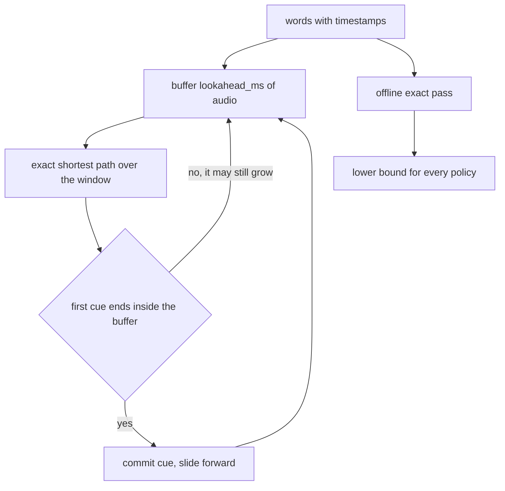
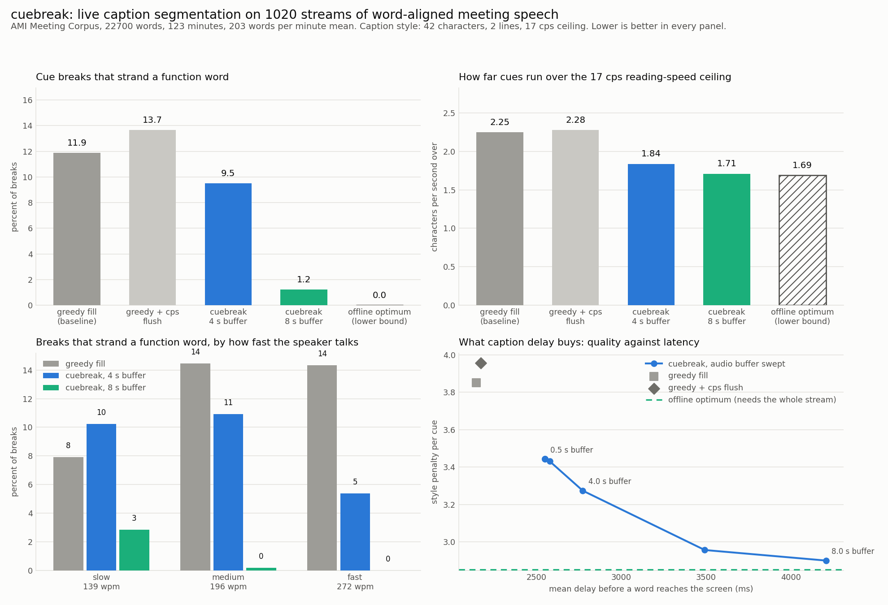

# cuebreak

Live captions have to break a sentence before they have heard it. cuebreak
decides where, by solving the exact segmentation problem over a bounded audio
buffer, and measures what the buffer costs in caption delay.

## The problem

A live caption writer gets words one at a time from a recogniser and has to
decide, continuously, where one cue ends and the next begins. The decision is
irrevocable: once a cue is on screen it cannot be taken back. It is also made
blind, because the rest of the sentence has not been spoken yet.

Essentially every shipping pipeline makes that decision the same way: fill the
caption area to the character limit, flush, repeat. whisper.cpp's `--max-len`
splitter does it, the SubRip and WebVTT writers in common media tooling do it,
and so do the streaming recogniser bridges that feed meeting captions. The
rule has no notion of where a phrase ends, so one cue boundary in eight lands
after a determiner or a preposition, leaving the reader holding "calculate
them by" while the words that complete it have not arrived. It has no notion
of line balance either, so a 42 character top line is routinely followed by a
12 character second line.

The published subtitling style guides (EBU-TT-D, and the BBC and Netflix
timed-text guides) all say what good looks like: keep a phrase intact, stay
under a reading-speed ceiling in characters per second, keep a cue up long
enough to read, balance the two lines. Nobody solves for it. The reason given
is always that a live captioner cannot see the future, which is true, and
which turns out not to be the obstacle it sounds like.

## What this does

A cue stays on screen until the next cue starts. That single fact makes the
cost of a cue covering words `i` to `j` a function of `i` and `j` alone, with
no dependence on how the rest of the stream is cut. Segmentation is then a
shortest path over word boundaries, and it can be solved exactly.

cuebreak ships three things:

- **`cuebreak/optimal.py`**: the exact offline segmenter. A single forward
  pass over the boundary graph returns the provably minimum total penalty.
  It is verified against brute-force enumeration of every segmentation on
  short streams. It needs the whole stream, so it is not deployable; it is
  the certificate, a lower bound that no policy, causal or otherwise, can
  beat under this cost model.
- **`cuebreak/online.py`**: the deployable segmenter. It buffers
  `lookahead_ms` of audio, solves the same exact shortest path restricted to
  the buffer, commits only the first cue, and slides forward. Two rules keep
  the restriction honest: the break penalty of the cue ending at the buffer
  edge is waived, because that boundary was observed rather than chosen, and
  a cue that fills the buffer is never committed, because a cue that might
  still grow cannot be judged. With a buffer that spans the stream it
  reproduces the offline optimum exactly.
- **`cuebreak/baseline.py`**: the two greedy rules, so the comparison is
  against what actually ships rather than a straw man. `segment_greedy` is
  fill-to-width with a sentence flush. `segment_greedy_cps` adds the obvious
  hardening, an early flush to respect the reading-speed ceiling, and sees
  exactly the same candidate boundaries cuebreak sees.

Everything is scored by one cue cost model (`cuebreak/model.py`) whose terms
are each linear in their natural unit, so no single term can swamp the rest by
being squared. The weights encode the priority order the style guides state:
phrase integrity first, then reading speed, then display time, then balance.

## Why it is interesting

The usual framing is that live captioning is a hard online problem, so you use
a heuristic. The real structure is different. The problem has an exact offline
solution, the online version is the same solution on a sliding window, and the
only thing you actually trade is **latency**, which is measurable.

That turns an unquantified engineering choice into a curve. The measured
answer here is that a four second audio buffer closes 58 percent of the gap
between fill-to-width and the certified optimum for 628 ms of extra caption
delay, and an eight second buffer closes 95 percent of it. Live broadcast
subtitling already runs three to six seconds behind the audio, so both points
sit inside the latency budget the medium accepts.

It also produces a clean negative result worth having. Over 1240 internal cue
boundaries, the exact optimum never once strands a function word, and yet the
fraction of cues exceeding the 17 cps reading-speed ceiling barely moves,
from 43.5 to 41.0 percent. Reading speed is set by how fast the speaker talks.
No choice of break points fixes it; only condensing the text does. The second
greedy baseline is the evidence: bolting a reading-speed flush onto
fill-to-width buys 4.5 points of violation rate and pays for it with more bad
breaks and worse balance.

## Architecture

FigJam board: https://www.figma.com/board/MxgKk9M17CyEDkESBGujbN

The diagram shows the online loop (recogniser words, audio buffer, window
shortest path, commit or wait, WebVTT out) alongside the offline pass that
produces the lower bound both are measured against.



## Results



The corpus is 1020 streams of real meeting speech from the AMI Meeting Corpus,
22700 words over 123 minutes, with the manual word-level alignments supplying
every timestamp. A stream is one uninterrupted run of speech from one speaker,
cut wherever that speaker pauses for more than 700 ms. The caption style is 42
characters, two lines, a 17 cps reading-speed ceiling.

| method | dangling breaks | cps over ceiling | line imbalance | penalty per cue | mean word delay |
| --- | --- | --- | --- | --- | --- |
| greedy fill (baseline) | 11.9% | 2.25 | 12.5 | 3.850 | 2144 ms |
| greedy + cps flush | 13.7% | 2.28 | 13.6 | 3.957 | 2171 ms |
| cuebreak, 1 s buffer | 14.0% | 1.78 | 4.5 | 3.443 | 2549 ms |
| cuebreak, 4 s buffer | 9.5% | 1.84 | 4.6 | 3.274 | 2772 ms |
| cuebreak, 6 s buffer | 3.1% | 1.73 | 4.9 | 2.957 | 3492 ms |
| cuebreak, 8 s buffer | 1.2% | 1.71 | 4.9 | 2.900 | 4207 ms |
| offline optimum | 0.0% | 1.69 | 4.8 | 2.853 | 5941 ms |

**The headline metric is the dangling-break rate**: the percentage of cue
boundaries that fall after a determiner, preposition or auxiliary, which every
style guide treats as the error to avoid. The baseline is fill-to-width, the
rule the tools ship, at 11.9 percent. With an eight second audio buffer
cuebreak reaches 1.2 percent, 90 percent fewer, and the offline optimum
reaches zero across all 1240 of its internal boundaries. Mean line imbalance
falls from 12.5 characters to 4.9, and the mean overrun above the
reading-speed ceiling falls from 2.25 cps to 1.71.

**What it costs is delay**, and the fourth panel is the honest version of the
claim. Mean delay before a word reaches the screen goes from 2144 ms under
fill-to-width to 2772 ms at the four second buffer and 4207 ms at the eight
second buffer. Fill-to-width is not delay-free either: a block caption cannot
appear before its own content has been spoken, which is most of that 2144 ms.
cuebreak adds 628 ms to 2063 ms on top of it.

**Where it loses**: at the four second buffer, on slow speakers, cuebreak's
dangling-break rate is 10.2 percent against fill-to-width's 7.9 percent. A
shallow buffer truncates the candidate boundaries, and if every reachable
boundary is bad the segmenter still has to pick one. That inversion is visible
in the bottom-left panel and it is gone by the six second buffer.

cuebreak optimises the break rule by construction, so the result worth
reporting is not that it wins on its own objective but that the win costs
under a second of extra lag, and that the rule the tools ship violates the
guideline on one boundary in eight.

All numbers come from `python bench.py`, which writes `docs/results.json`;
`python make_chart.py` draws the figure from that file and nothing else. The
eight second configuration segments 123 minutes of speech in 5.6 s of CPU
time, about 1300 times faster than real time, single threaded.

## How to run it

```bash
git clone https://github.com/joelvarun/cuebreak
cd cuebreak
pip install -r requirements.txt

python demo.py                 # one stream, segmented four ways, side by side
python bench.py                # the full corpus, writes docs/results.json
python make_chart.py           # redraws docs/before_after.png from that json
python -m pytest tests -q      # or: python tests/test_cuebreak.py
```

`data/streams.json` is committed, so nothing above touches the network. To
rebuild it from the upstream annotations (a 23 MB download, see
`data/ATTRIBUTION.md`):

```bash
python tools/build_streams.py
```

Useful flags:

```bash
python demo.py --stream 552 --lookahead 2500 --vtt
python bench.py --cps-limit 20 --max-chars 37   # a different caption style
```

In your own code:

```python
from cuebreak import CueModel, segment_online, to_webvtt
from cuebreak.model import Word

words = [Word("Captions", 0), Word("arrive", 410), Word("one", 700),
         Word("word", 880), Word("at", 1120), Word("a", 1210),
         Word("time.", 1340)]
cues = segment_online(words, CueModel(), end_of_audio_ms=1900,
                      lookahead_ms=4000).cues
print(to_webvtt(cues))
```

## Example output

`python demo.py` picks the stream where fill-to-width and the optimum disagree
most, and segments it four ways. Real output, trimmed to two of the four:

```
stream 154: EN2001a, speaker C  (the stream where the rules disagree most)
19 words, 9.0 s, 126 words per minute, 11.7 characters per second

  If we need just frequencies, maybe we should just calculate them by
  using Perl or something. I don't know.

caption style: 42 characters, 2 lines, 17 cps ceiling

greedy fill to width
--------------------------------------------------------------------------
    9.4 cps       7000 ms
    | If we need just frequencies, maybe we      |
    | should just calculate them by              |
      <- break strands 'by'
   17.1 cps OVER  1400 ms
    | using Perl or something.                   |
   31.7 cps OVER   410 ms
    | I don't know.                              |
  3 cues, total penalty 18.40

cuebreak online (1500 ms buffer, mean word delay 3849 ms)
--------------------------------------------------------------------------
    9.5 cps       2950 ms
    | If we need just frequencies,               |
   12.5 cps       6080 ms
    | maybe we should just calculate them        |
    | by using Perl or something. I don't know.  |
  2 cues, total penalty 4.29
```

Fill-to-width cuts after "by", then flashes "I don't know." for 410 ms at 31.7
cps, four hundred milliseconds of screen time for a thirteen character cue.
cuebreak cuts at the comma instead and merges the tail: two cues, no stranded
word, nothing over the ceiling. Here a 1.5 s buffer is already enough to reach
the offline optimum, which produces the identical segmentation.

`python tests/test_cuebreak.py` verifies the claims that matter, including the
exactness one:

```
ok   test_bigger_buffer_costs_delay_on_average
ok   test_bigger_buffer_delays_the_first_decision
ok   test_dp_matches_brute_force
ok   test_every_cue_fits_the_caption_area
ok   test_first_fit_wrap_never_loses_a_word
ok   test_optimum_is_a_lower_bound_for_every_policy
ok   test_segmentations_cover_every_word_once
ok   test_stream_sized_buffer_reaches_the_optimum
ok   test_suffix_bounds_agree_with_forward_pass
ok   test_webvtt_timestamps_are_ordered
0 failure(s)
```

## Data

Word timings come from the AMI Meeting Corpus manual annotations, used under
CC BY 4.0. Only the word strings and their millisecond offsets are
redistributed here. See `data/ATTRIBUTION.md` for the citation.

## Licence

MIT, see `LICENSE`.
